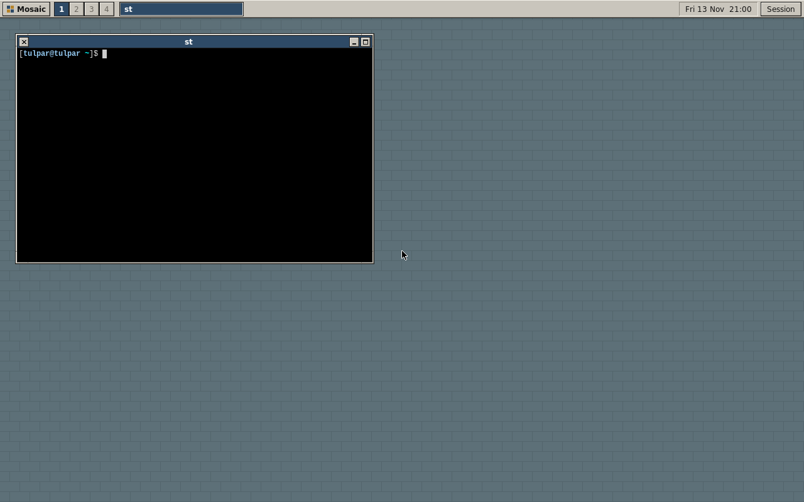
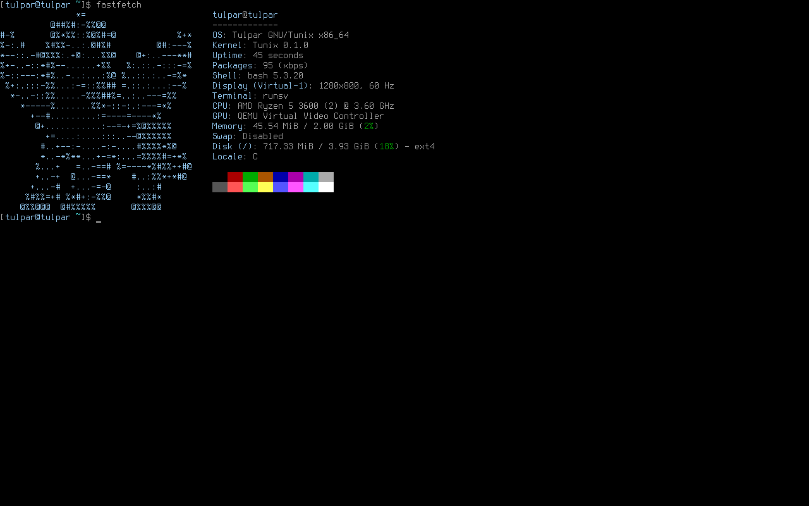
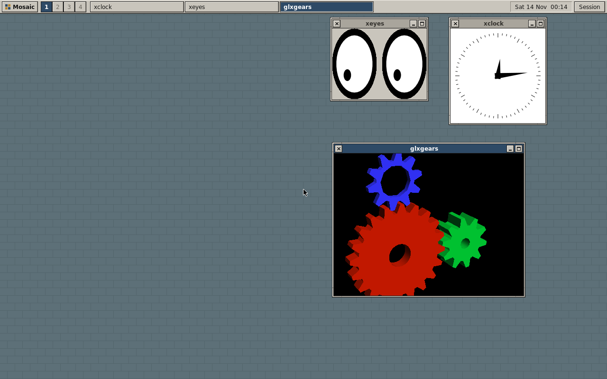
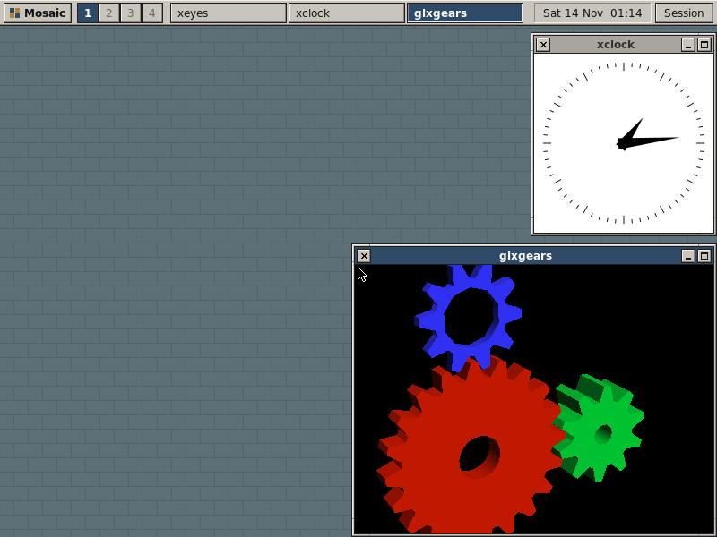

# Tulpar

[]()

Tulpar is an OS built with the [Tunix](https://github.com/tuna4ll/tunix)
kernel and using GNU tools for the userland, with glibc as its C library,
runit as its init and [Mosaic](https://github.com/tuna4ll/mosaic) as its
desktop. This repository holds scripts and tools to build the OS from the
ground up on a Linux-based system.

Tulpar is named after the [Tulpar](https://en.wikipedia.org/wiki/Tulpar), the
winged horse of Turkic mythology.






## Running

Tulpar is built for x86_64 and aarch64 as a disk image, `tulpar.img`, with an
EFI system partition holding Limine and the kernel and an ext4 root. Tunix
mounts its root from disk and has no initramfs, so there is no live ISO.

### On virtual machines

With a locally built image, one can run it in QEMU with:

```bash
make run
```

which builds the image first if there is none, and boots it with:

```bash
qemu-system-x86_64 -enable-kvm -cpu host -m 4G -M q35 -smp 2 \
  -drive file=build-x86_64/tulpar.img,format=raw \
  -device qemu-xhci -device usb-kbd -device usb-tablet \
  -netdev user,id=net0 -device virtio-net-pci,netdev=net0,disable-legacy=on \
  -serial stdio
```

To do the same with an aarch64 image, one can do:

```bash
make run ARCH=aarch64
```

which boots QEMU's `virt` machine through UEFI, with the root on NVMe and
`ramfb` as the screen:

```bash
qemu-system-aarch64 -M virt -cpu cortex-a72 -m 4G -smp 2 \
  -bios /usr/share/edk2/aarch64/QEMU_EFI.fd \
  -drive file=build-aarch64/tulpar.img,if=none,id=disk,format=raw \
  -device nvme,drive=disk,serial=tulpar -device ramfb \
  -device qemu-xhci -device usb-kbd -device usb-tablet \
  -netdev user,id=net0 -device virtio-net-pci,netdev=net0,disable-legacy=on \
  -serial stdio
```

The aarch64 UEFI firmware comes from the EDK2 project; its path differs between
distributions and can be given as `AARCH64_FIRMWARE=`.

Log in as `tulpar` or `root`, both without passwords, and run `startx` for
the Mosaic desktop. dhcpcd brings up the network on boot, and packages can be
installed or updated with `xbps-install` from
[tulpar-packs](https://github.com/tuna4ll/tulpar-packs).

> [!NOTE]
> Depending on your distribution, to use Linux's KVM, you might need to add your
> user to the `kvm` usergroup, as such:
> ```bash
> usermod -aG kvm <user>
> ```
> Then log out and log back in.

### On physical hardware

Tulpar should run on 64-bit x86 machines that Tunix supports, booting by BIOS
or UEFI, and on 64-bit ARM machines with UEFI that Tunix supports. To run it, one can write `tulpar.img` to a USB flash drive or a disk
and boot from it.

## Building

A list of the tools needed for compilation of the OS are:

- `awk`, `bash`, `curl`, `git`, `grep`, `gzip`, `sed`, `tar`, `wget` and `zstd`, `find` and `xargs` (from `findutils`), `chroot` and `sha256sum` (from `coreutils`), `free` (from `procps`), `flock`, `mount` and `unshare` (from `util-linux`), and `perl` and `xzcat` (from `xz`) for Jinx.
- `fallocate`, `sfdisk` and `partx` (from `util-linux`), `mkfs.ext4` (from `e2fsprogs`), and `mformat` and `mcopy` (from `mtools`) for building the image.
- `qemu` for testing, if wanted.

The project uses [Jinx](https://github.com/Mintsuki/jinx) as its build system.
The `jinx` script in the tree fetches the commit of Jinx that Tulpar is pinned
to on first use, and runs it. The instructions to build a system are:

```bash
make image                # x86_64
make image ARCH=aarch64   # aarch64
```

or, by hand:

```bash
mkdir build-<architecture> && cd build-<architecture>
../build-support/makeimg.sh
```

> [!NOTE]
> On certain distros, like Ubuntu 24.04, one may get an error like:
> ```
> unshare: write failed /proc/self/uid_map: Operation not permitted
> ```
> In that case, it likely means apparmor is preventing the use of user namespaces,
> which `jinx` and `makeimg.sh` need. One can enable user namespaces by running:
> ```sh
> sudo sysctl kernel.apparmor_restrict_unprivileged_userns=0
> ```

By default the image holds the Mosaic desktop and a native toolchain (GCC,
binutils, make). For a minimal command-line only
environment, one can pass nothing (or a list of desired packages, `base` is
implied) as `PKGS_TO_INSTALL`:

```bash
PKGS_TO_INSTALL= ../build-support/makeimg.sh
```

Single packages can be built with `../jinx build <package>` from the build
directory.

## Contributing

Tulpar accepts contributions for new packages or any other kind of changes
using the pull request system of GitHub. Packages are recipes under `recipes/`
and `host-recipes/`, in the same format as Gloire's.

## License

Tulpar is distributed under the GPL-3.0.
